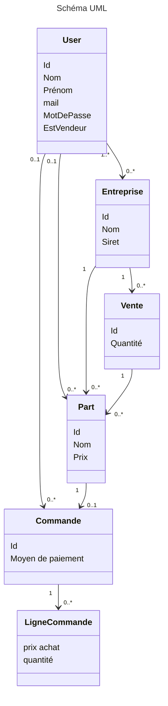

# Marketplace d'achat de part en bourse ou de parts de société
Liste de rôles

## Rôles

- User -> Acheter des parts
- Patron -> Voir le financement et qui aide, plus ajouter une société 
- Super admin -> dashboard de tous les projets

## Règles de gestions :

- Gestion d'une même part vendue deux fois
- Gestion de l'heure d'achat d'une part
- Une entreprise ne peux pas fermée si il y a des parts dedans

## Risques métiers en cas d’incident :

- plus de suivi des investissements (acheteurs et vendeurs)
- erreurs de paiments

## UserStroy :

- En tant que visiteur, je n'ai accès qu'à la partie vente de parts de socités
- En tant que user, j'ai également accès à la vente mais je peux aussi placer ma société pour avoir des parts
- En tant qu'admin, j'ai accès à l'integralité de la plate-forme (achat comme vente), ainsi qu'un dashboard spécial listant toutes les sociétés et tous les acheteurs

## Matrice des droits :

| Rôle | Voir les socités en ventes | Voir les acheteurs sur une société | Supprimer des sociétés | Ajouter une société | Acheter une part | Créer un compte | Supprimer son compte | Voir tous les comptes | Retirer sa mise sur des parts | Supprimer une société |
|:---:|:---:|:---:|:---:|:---:|:---:|:---:|:---:|:---:|:---:|:---:|
| Admin | X | X | X | X |  | X | X | X |  | X |
| User | X | X | X | X | X | X | X |  | X | X |
| visiteur | X |  |  |  | X | X | X |  | X |  |

## Schéma UML

