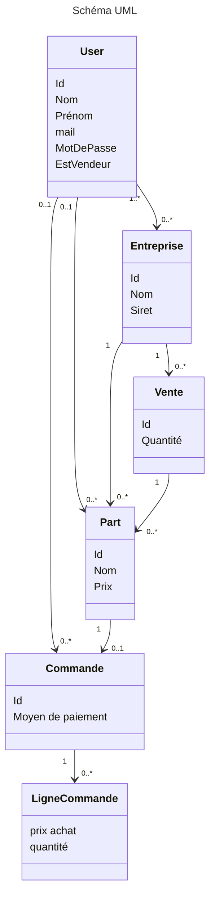
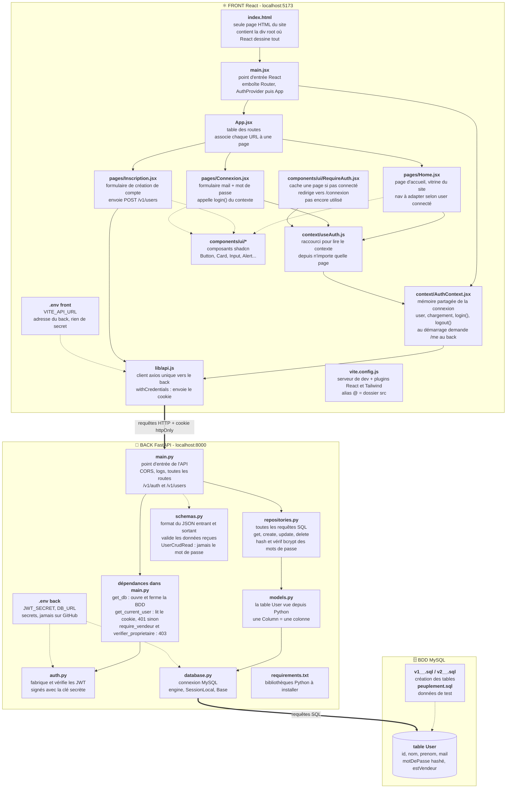

# Marketplace d'achat de part en bourse ou de parts de société
Liste de rôles

## Rôles

- User -> Acheter des parts
- Patron -> Voir le financement et qui aide, plus ajouter une société 
- Super admin -> dashboard de tous les projets

## Règles de gestions :

- Gestion d'une même part vendue deux fois
- Gestion de l'heure d'achat d'une part
- Une entreprise ne peux pas fermée si il y a des parts dedans

## Risques métiers en cas d’incident :

- plus de suivi des investissements (acheteurs et vendeurs)
- erreurs de paiments

## UserStroy :

- En tant que visiteur, je n'ai accès qu'à la partie vente de parts de socités
- En tant que user, j'ai également accès à la vente mais je peux aussi placer ma société pour avoir des parts
- En tant qu'admin, j'ai accès à l'integralité de la plate-forme (achat comme vente), ainsi qu'un dashboard spécial listant toutes les sociétés et tous les acheteurs

## Matrice des droits :

| Rôle | Voir les socités en ventes | Voir les acheteurs sur une société | Supprimer des sociétés | Ajouter une société | Acheter une part | Créer un compte | Supprimer son compte | Voir tous les comptes | Retirer sa mise sur des parts | Supprimer une société |
|:---:|:---:|:---:|:---:|:---:|:---:|:---:|:---:|:---:|:---:|:---:|
| Admin | X | X | X | X |  | X | X | X |  | X |
| User | X | X | X | X | X | X | X |  | X | X |
| visiteur | X |  |  |  | X | X | X |  | X |  |

## Schéma UML


## Installation des dépendances

Les commandes sont en **PowerShell**. Pour chaque dépendance : si la version requise est déjà installée, on n'installe pas, sinon on installe.

### 1. Outils système

| Outil | Version requise |
|:---|:---:|
| Node.js | >= 20 |
| Python | >= 3.10 |

```powershell
# Node.js >= 20
$nodeOk = $false
try { $nodeOk = ([version](node -v).TrimStart('v')).Major -ge 20 } catch {}
if ($nodeOk) { Write-Host "Node OK, pas d'installation" } else { winget install OpenJS.NodeJS.LTS }

# Python >= 3.10
$pyOk = $false
try { $pyOk = ([version](python --version).Split(' ')[1]) -ge [version]'3.10' } catch {}
if ($pyOk) { Write-Host "Python OK, pas d'installation" } else { winget install Python.Python.3.12 }
```

Redémarrer le terminal après une installation.

### 2. Back (FastAPI) : à la racine du projet

| Paquet | Version |
|:---|:---:|
| fastapi | >= 0.110 |
| uvicorn | >= 0.29 |
| sqlalchemy | >= 2.0 |
| mysqlclient | >= 2.2 |
| pydantic | >= 2.0 |
| email-validator | >= 2.0 |
| passlib | 1.7.4 |
| bcrypt | 4.0.1 (exactement, passlib est incompatible avec bcrypt >= 5) |

```powershell
function Install-PipIfNeeded($name, $min, $exact = $false) {
    $line = pip show $name 2>$null | Select-String '^Version:'
    if ($line) {
        $v = [version]($line.ToString().Split(':')[1].Trim())
        $ok = if ($exact) { $v -eq [version]$min } else { $v -ge [version]$min }
        if ($ok) { Write-Host "$name $v OK, pas d'installation"; return }
    }
    if ($exact) { pip install "$name==$min" } else { pip install "$name>=$min" }
}

Install-PipIfNeeded fastapi 0.110
Install-PipIfNeeded uvicorn 0.29
Install-PipIfNeeded sqlalchemy 2.0
Install-PipIfNeeded mysqlclient 2.2
Install-PipIfNeeded pydantic 2.0
Install-PipIfNeeded email-validator 2.0
Install-PipIfNeeded passlib 1.7.4 $true
Install-PipIfNeeded bcrypt 4.0.1 $true
```

Lancer l'API : `uvicorn main:app --reload`

### 3. Axios (racine du projet)

```powershell
$ax = npm ls axios --depth=0 2>$null | Select-String 'axios@(\d+)'
if ($ax -and [int]$ax.Matches[0].Groups[1].Value -ge 1) { Write-Host "axios OK, pas d'installation" } else { npm install }
```

### 4. Front (React + Vite) : dossier `Front/mon-projet-react`

| Paquet | Version |
|:---|:---:|
| react / react-dom | ^19 |
| react-router-dom | ^7 |
| @tanstack/react-query | ^5 |
| tailwindcss / @tailwindcss/vite | ^4 |
| @base-ui/react | ^1 |
| shadcn | ^4 |
| lucide-react | ^1 |
| class-variance-authority | ^0.7 |
| cn | ^0.5 |
| tw-animate-css | ^1 |
| @fontsource-variable/geist | ^5 |
| vite | ^8 (dev) |
| @vitejs/plugin-react | ^6 (dev) |
| eslint + plugins, globals, @types/react(-dom) | voir package.json (dev) |

Les versions exactes sont dans `package.json` : `npm install` ne retélécharge que ce qui est absent ou pas à la bonne version.

```powershell
cd Front/mon-projet-react
npm ls --depth=0 --silent 2>$null
if ($LASTEXITCODE -eq 0) { Write-Host "Toutes les dépendances sont à la bonne version, pas d'installation" } else { npm install }
npm run dev
```


